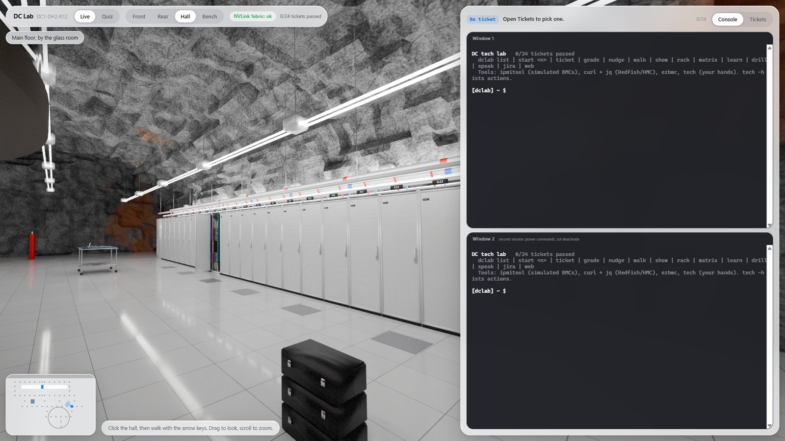
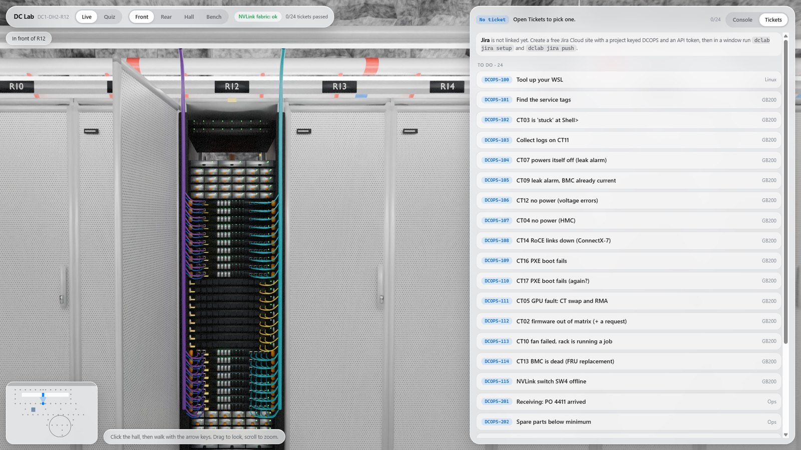
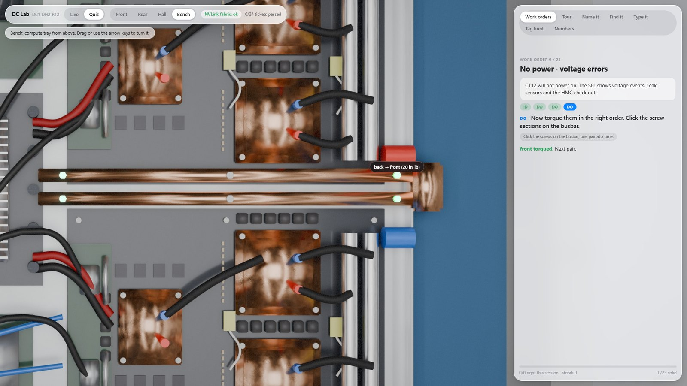

# DC Tech Lab

A practice lab for GPU data center operations work. You get a simulated NVIDIA GB200 NVL72 rack that
answers real Linux tools, 24 graded tickets, and a path-traced data hall you can walk through in the
browser.



| | |
|---|---|
|  |  |

## What is in it

- **A rack that talks back.** 18 compute trays and 9 NVLink switches, each with a BMC. `ipmitool`
  (lanplus: sel, sdr, chassis, mc, fru, lan, sol) and Redfish over HTTPS both work against them. The
  serial-over-LAN console boots through POST, takes F2/F11, and drops to an EFI shell or a support
  live image.
- **24 tickets.** Each one teaches the facts first, then gives you the job, then grades what you
  actually did. Three hint levels: `nudge`, `walk`, `show`.
- **Work orders on a 3D model.** Read the ticket, identify the part by clicking it, then do the
  operation the procedure calls for. 25 work orders plus six drill modes.
- **A hall you can walk.** 58 viewpoints rendered with Blender Cycles. Rack R12 follows what you do
  in the terminals: LEDs, pulled trays, the tray on the bench.
- **Optional extras.** A Jira Cloud link for the tickets, and an RHCSA/RHCE task track for two
  Rocky VMs (`rhcsa-rhce/`).

## You need

- Windows 11 with WSL 2 and an Ubuntu distro (tested on 24.04) with systemd on.
- In the distro: `python3`, `openssl`, `curl`, `jq`, `iproute2`.
- A browser with WebGL 2.

## Start

```powershell
.\START-DCLAB.ps1
```

The script copies `lab/` to `~/dclab` in WSL, starts the simulated BMC service (as root, on loopback
addresses only), and opens the lab page. Everything listens on 127.0.0.1.

| In the page | What it is |
|---|---|
| **Walk** | Click the hall, then use the arrow keys (or W A S D). Up/Down step, Left/Right turn. Drag to look, scroll to zoom. The floor plan (bottom left) shows where you are; click a dot to go there. |
| **Live → Console** | Two real terminals running the lab shell. |
| **Live → Tickets** | The ticket board: In progress / To do / Done. Open a ticket, read TEACH and DO, press **Start in Window 1**. |
| **Quiz → Work orders** | A ticket, then **ID** the part by clicking it, then **DO** the operation. |
| Quiz → Tour / Name it / Find it / Type it / Tag hunt / Numbers | Drills on every part. |
| Front / Rear / Hall / Bench | Jump to a spot. On the bench, drag (or arrow keys) to turn the tray. |

## In a terminal

```
dclab list            all 24 tickets
dclab start 104       start a ticket (TEACH first, then DO)
dclab grade           check your work
dclab nudge | walk | show     three hint levels
dclab learn leak      the facts for a topic        dclab drill leak     test yourself
dclab rack            trays, service tags, BMC IPs  (every BMC: admin / admin)
dclab speak           60 seconds, out loud
```

Tools on the path: `ipmitool` (simulated BMCs), `curl ... | jq` (Redfish / HMC log on
`https://<BMC_IP>`), `ezbmc <BMC_IP>`, `script`, and `tech` for your hands (`tech -h`).

## Jira (optional)

The lab can drive a Jira Cloud board.

1. Create a free Jira site with a **Kanban** project keyed `DCOPS`.
2. Create an API token for your Atlassian account.
3. In a lab terminal: `dclab jira setup`, then `dclab jira push`.

After that every lab ticket is a Jira issue. `dclab start` moves it to In Progress. A passing
`dclab grade` posts your resolution as a comment and moves it to Done. The token is stored in
`~/dclab/state/jira.json` (mode 0600) and nowhere else.

## What is real and what is simulated

- Commands, flags, file names and the order of work follow the author's notes from a GB200 NVL72
  field-service class.
- The rack, the BMCs and the Redfish service are simulators. `ezbmc` and `tech` are stand-ins.
- Firmware build numbers are placeholders, except the package and BMC build the tickets call the
  site standard.
- The pictures are path-traced renders of a scene modeled from reference photos and diagrams. Part
  names, counts and positions are right; exact dimensions are not.
- The Jira link has been tested against a local stand-in for the Jira API (`lab/tests/jira_mock.py`),
  not against a live site.

## Folders

- `lab/` : the simulator (`lib/`), the fake tools (`bin/`), the web app (`web/`), tests (`tests/`).
- `blender/` : the scene and render scripts. `python hall3.py final 128` renders every view (needs
  the `bpy` module and a GPU; about 85 minutes on an RTX 3090). The rendered images are in
  `lab/web/img`, so you do not have to.
- `tools/` : `make_ids.py` rebuilds the click map, `record_demo.py` drives the page in a real browser.
- `rhcsa-rhce/` : 11 RHCSA and 8 RHCE tasks with graders.

## Tests

```
python3 ~/dclab/tests/solve_all.py     # every ticket must fail untouched and pass when solved
```

Browser tests (Windows side, need `pip install playwright` and `playwright install chromium`):

```
python tools/test_walk.py                      # arrow keys, W A S D, floor plan
python tools/record_demo.py live bench quiz    # a live ticket, the bench flow, six work orders
```

## Credits

three.js and xterm.js are vendored under the MIT license (`lab/web/vendor/NOTICE.md`).

This is a personal study project. It is not affiliated with or endorsed by NVIDIA, Dell or any data
center operator. Product names belong to their owners.
